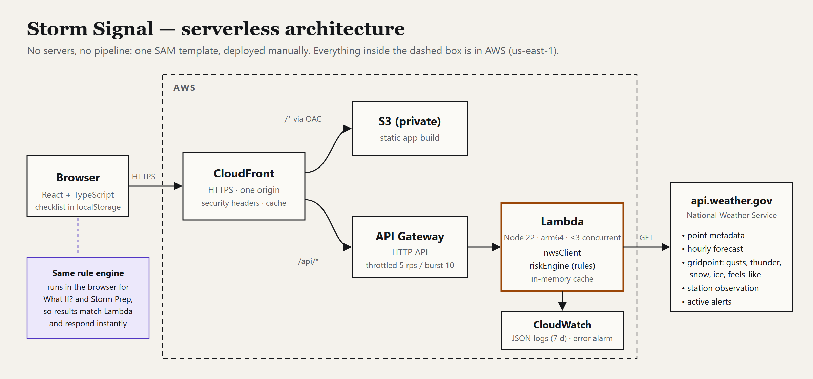

# Storm Signal



**Know the threat. Understand the impact. Prepare before it hits.**

A serverless weather decision-support app. It turns live National Weather Service forecasts and alerts into an explained risk level, a What If? comparison of plans, and a hazard-specific preparation checklist. Built for the AWS Builder Center Weekend Challenge "No Pipeline, No Problem" (Nov 13–16, 2026).

- **Overview:** Storm Signal level (Low → Critical, or Unknown) for the next 24 h, with the evidence behind it; official NWS alerts shown separately; current observation; hourly table.
- **What If?:** driving, outdoor event, or home prep, compared for now / +3 h / +6 h with activity-specific rules and plain-language differences.
- **Storm Prep:** tasks chosen by hazard and by what you care about, each with a reason, timing and source; Before / During / After; saved in your browser.

All classifications come from deterministic, documented rules (`shared/`). No generative AI, no accounts, no server-side user data.

## Run locally (Windows / PowerShell)

Requires Node.js ≥ 22.12.

```powershell
npm ci
npm run dev        # web on http://127.0.0.1:5173, API on 127.0.0.1:8787
npm test           # 45 unit/integration tests
npm run e2e        # 26 Playwright browser + axe accessibility tests (desktop and mobile)
npm run build      # type check, frontend to dist/, Lambda bundle to build/handler.mjs
npx tsx scripts/live-check.ts   # real NWS check for all cities
npx tsx scripts/screenshots.ts  # regenerate docs/screenshots (needs npm run dev)
```

Use the source menu in the header to switch between **Live NWS data** and four **simulated** scenarios: thunderstorms with wind, a tornado warning, a winter storm, and an NWS failure. Simulated data is always bannered.

## Coverage

Nine city-center points: Kalamazoo, Grand Rapids, Battle Creek, Portage, Benton Harbor, South Haven, Detroit (MI), Chicago (IL), Indianapolis (IN). Not address-level, not nationwide.

## Deploy (manual, creates billable resources)

```powershell
aws sts get-caller-identity   # confirm the intended account; only if expired: aws sso login --profile <your SSO profile>
.\scripts\deploy.ps1 -UserAgent "StormSignal/0.2 (https://your-site, you@example.com)" -BudgetEmail you@example.com
```

Deploys `template.yaml` to `us-east-1` (the account default): private S3 + CloudFront, HTTP API → Lambda, CloudWatch logs and an alarm, and an optional budget. Then syncs `dist/`. Teardown steps are in `docs/architecture.md`.

## Docs

- `docs/architecture.md`: AWS design, NWS data, the rule tables, security and cost controls
- `docs/design.md`: wireframes, hierarchy, design tokens
- `docs/testing.md`: what is tested and what was verified by hand
- `docs/demo-script.md`: video under three minutes
- `docs/submission.md`: Builder Center article draft (unpublished)
- `docs/rules-compliance.md`: every official rule mapped to status and evidence
- `docs/PROGRESS.md`: status log
- `NOTICE.md`: third-party licenses and attributions

## Limits

Storm Signal is a planning aid, not an emergency warning service. It doesn't retrieve road conditions, predict damage, or say when something is safe. An empty NWS alert list is not an all-clear. Keep official alerts enabled on your phone.
