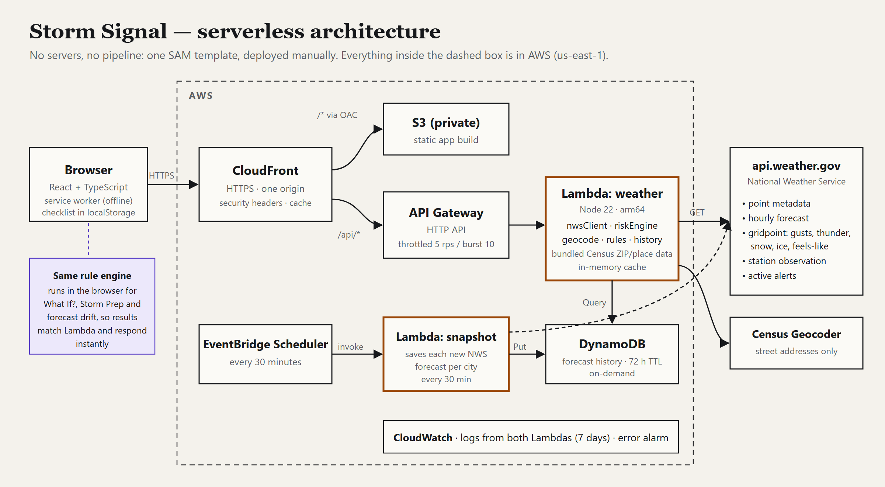

# Storm Signal — architecture

## Flow

```
Browser ──HTTPS──▶ Amazon CloudFront ──(OAC, SigV4)──▶ Amazon S3 (private bucket: React build)
                        │
                        └── /api/* ──HTTPS──▶ API Gateway HTTP API (throttled 5 rps / burst 10)
                                                   │
                                                   ▼
                                         AWS Lambda (Node 22, arm64)            
                                           nwsClient ─▶ api.weather.gov
                                           riskEngine ─▶ assessment
                                                   │
                                                   ▼
                                         CloudWatch Logs (7 days) + Errors alarm

EventBridge Scheduler (every 30 min) ──▶ Lambda: snapshot ──Put──▶ DynamoDB (forecast history, 72 h TTL)
                                                                         ▲
                                       Lambda: weather ──Query (/api/history)┘
```



One origin for users: CloudFront serves the static app and proxies `/api/*`, so there is no CORS surface and no API key or AWS credential in the browser. Optional AWS Budget emails at 50% actual / 100% forecast of a monthly limit.

**Why these services, and not more:**

| Need | Choice | Why |
| --- | --- | --- |
| HTTPS static hosting | S3 + CloudFront with Origin Access Control | Bucket stays fully private, TLS and caching for free. |
| API | API Gateway HTTP API → Lambda | Built-in route throttling (a Function URL has none). Pay per request. |
| Compute | One Lambda function | Read-only NWS fetch plus a deterministic rule engine; about 1–2 s cold. |
| Forecast history | EventBridge Scheduler → snapshot Lambda → DynamoDB (on-demand, TTL) | Saves each **new NWS issuance** per listed city (deduplicated by the forecast's issue time), so the app can show how the forecast for the same hours has changed. Without a schedule there would be no history; without TTL storage would grow forever. |
| Place search | Bundled Census Gazetteer + live Census Geocoder | ZIPs and "City, ST" resolve from public-domain Census tables bundled in the Lambda (no key, no third-party service). Only street addresses are sent to the U.S. Census Geocoder. |
| Caching | In-memory, inside Lambda | 2-minute cache for successful responses and 12-hour cache for NWS point metadata, plus coalesced in-flight requests. DynamoDB isn't worth it at this scale. |
| Monitoring | CloudWatch Logs + one alarm | Structured JSON log line per request (location, latency, source availability, level). No user data is logged. |
| IaC | AWS SAM (`template.yaml`) | Manual `sam deploy`. No pipeline to manage. |

Not used, on purpose: Step Functions, SQS, Bedrock/any LLM, Cognito, a map/radar provider. None of them would improve the product. DynamoDB and EventBridge Scheduler earned their place with one feature that needs them: forecast history.

## Code map

| File | Role |
| --- | --- |
| `backend/weather.ts` | NWS client (`nwsClient`): point lookup → hourly forecast, gridpoint layers, nearest station observation, active alerts. URL allow-listing, 8 s timeouts, payload caps, unit conversion, normalization. |
| `backend/handler.ts` | Lambda handler: `/api/weather` (listed city or `pt:lat,lon` for any U.S. point), `/api/geocode`, `/api/history`, `/api/rules`, `/api/locations`, `/api/health`; plus the `snapshot` entry point for EventBridge Scheduler. |
| `backend/geocode.ts` | ZIP/place search from bundled Census data (`backend/data/`, built by `scripts/build-gazetteer.ts`), street addresses via the Census Geocoder, point-id validation (U.S. only, 3-decimal rounding). |
| `backend/history.ts` | History storage (DynamoDB in AWS, a JSON file in `.data/` locally, memory in tests) and `takeSnapshots`. |
| `shared/drift.ts` | Compares the same forecast hours between the oldest snapshot in the last 24 h and now: changes in gusts, thunder, snow, ice, temperature; trend (worse / better / steady / shifting). |
| `shared/counterfactual.ts` | "What would change the level": the threshold each top factor must stay under, and the level that would result. |
| `shared/rulesCatalog.ts` | Every rule and threshold as JSON (`/api/rules`). |
| `backend/local.ts` | Same handler on `127.0.0.1:8787` for local development. |
| `shared/rules.ts` | Rule machinery shared by both engines: thresholds, windows, alert mapping, limitations. |
| `shared/riskEngine.ts` | Overview level for the next 24 h. |
| `shared/impactEngine.ts` | What If?: activity rules, three-option comparison, plain-language differences. |
| `shared/preparationEngine.ts` | Storm Prep task library, hazard/category filtering, timing, Before/During/After. |
| `shared/locations.ts` | Nine validated city-center points. |
| `src/` | React UI (Overview, What If?, Storm Prep), place search, share links (`share.ts`), calendar export (`ics.ts`), labelled simulated scenarios and history. `public/sw.js` keeps the app and last data available offline. |

The engines live in `shared/` so the Lambda (overview assessment) and the browser (interactive What If?, simulated scenarios) run exactly the same deterministic code.

## NWS data used

| Endpoint | Fields |
| --- | --- |
| `/points/{lat},{lon}` | forecastHourly, forecastGridData, observationStations URLs (validated against fixed path patterns) |
| `/gridpoints/{wfo}/{x},{y}/forecast/hourly` | time, temperature, wind speed text, precip chance, short forecast |
| `/gridpoints/{wfo}/{x},{y}` | `windGust` (km/h), `probabilityOfThunder` (%), `snowfallAmount` and `iceAccumulation` (mm, spread over each interval), `apparentTemperature` (°C) |
| `/stations/{id}/observations/latest` | current conditions at the nearest station |
| `/alerts/active?point=` | active alerts with severity, urgency, onset/ends, full instruction and description |

A layer with an unexpected unit is dropped and becomes *unknown*, never zero. Each source fails independently and is reported separately.

## Classification rules

Levels: Low < Moderate < Elevated < High < Critical, plus **Unknown**. The highest triggered rule sets the level. Any missing source (forecast, gridpoint data or alerts) or incomplete time coverage makes Low impossible: with no other triggered rule, the result is Unknown.

**Official alerts** (Storm Signal floor; NWS severity is always shown alongside, unchanged): advisory/statement → Moderate; watch → Elevated; warning → High; tornado warning/emergency, flash flood emergency, extreme wind, hurricane, storm surge, tsunami, or any warning with NWS severity *Extreme* → Critical. Warnings that call for immediate action (tornado, severe thunderstorm, flash flood, extreme wind, snow squall, dust storm, storm surge, hurricane, tsunami, or urgency *Immediate*) override What If? and Storm Prep.

**Overview thresholds (next 24 h):**

| Factor | Moderate | Elevated | High | Critical | Basis |
| --- | --- | --- | --- | --- | --- |
| Wind gust (peak) | ≥30 mph | ≥46 | ≥58 | ≥75 | 46/58 mph match common NWS Wind Advisory / High Wind and severe-gust criteria |
| Sustained wind | ≥25 mph | ≥31 | ≥40 | – | 31/40 mph match common Wind Advisory / High Wind Warning criteria |
| Thunder chance | ≥15% | ≥40% | – | – | Thunder chance alone doesn't indicate severity, so it's capped at Elevated |
| Snow total | ≥1 in | ≥4 | ≥8 | – | Storm Signal choice |
| Ice total | – | ≥0.01 in | ≥0.25 | – | Any glaze is hazardous; 0.25 in is a common Ice Storm Warning criterion |
| Feels-like high | ≥95°F | ≥105 | ≥115 | – | Storm Signal choice |
| Feels-like low | ≤0°F | ≤−20 | ≤−35 | – | Storm Signal choice |

Forecast wording (e.g. "Thunderstorms", "Freezing Rain", "Blizzard") is only used for hours where the matching numeric layer is missing, so a known 0 in of snow beats "slight chance snow showers".

**Activity thresholds (What If?)** differ by exposure. Examples: driving treats any ice as High and gusts ≥40 mph as Elevated (crosswinds); an outdoor event treats thunder chance ≥25% as Elevated and ≥50% as High (no lightning shelter outdoors), and gusts ≥35 mph as Elevated (tents and canopies); home prep uses gusts ≥30 / 46 / 58 mph for securing objects. The full tables are in `shared/impactEngine.ts`.

**Explicitly not done:** no accident or damage probabilities, no road-condition inference (none is retrieved), no "safe" verdicts, no generative AI.

## Security and cost controls

- Private S3 bucket (Block Public Access, BucketOwnerEnforced, SSE-S3, TLS-only policy). CloudFront reads it through OAC, scoped by distribution ARN.
- Each Lambda has its own role. Weather: write its own logs, `dynamodb:Query` on the history table. Snapshot: write its own logs, `PutItem`/`Query` on the history table. Nothing else.
- Lambdas only call fixed `api.weather.gov` URL shapes and the fixed Census Geocoder endpoint (no user-supplied URLs). Locations are an allow-listed id or a validated U.S. `pt:lat,lon` with at most 3 decimals. GET only.
- CloudFront Managed-SecurityHeadersPolicy (HSTS, nosniff, frame-options, referrer-policy).
- HTTP API throttling (5 rps / burst 10) bounds cost and NWS load, and the account's own Lambda concurrency limit is a hard ceiling. These limit spend but are **not** a hard billing cap. Use the optional budget alert.
- Checklist state stays in the browser (`localStorage`). There are no accounts and no server-side user data. "Use my location" is opt-in and rounded to about 1 km in the browser. Search text is never logged or stored, and custom points are logged only as `point`. Forecast history holds NWS data for the listed cities only.
- Reserved concurrency is an optional parameter (`WeatherReservedConcurrency`, default off). New AWS accounts have a concurrency limit of 10, and AWS keeps all 10 unreserved, so the first deploy failed when it tried to reserve 3 and 1 (Nov 13). The snapshot runs once every 30 minutes with a 2-minute timeout, so runs can't overlap. It visits 9 cities and skips any whose NWS forecast hasn't been reissued.

## Teardown

```bash
aws s3 rm s3://<SiteBucketName> --recursive
sam delete --stack-name storm-signal --region us-east-1
```
