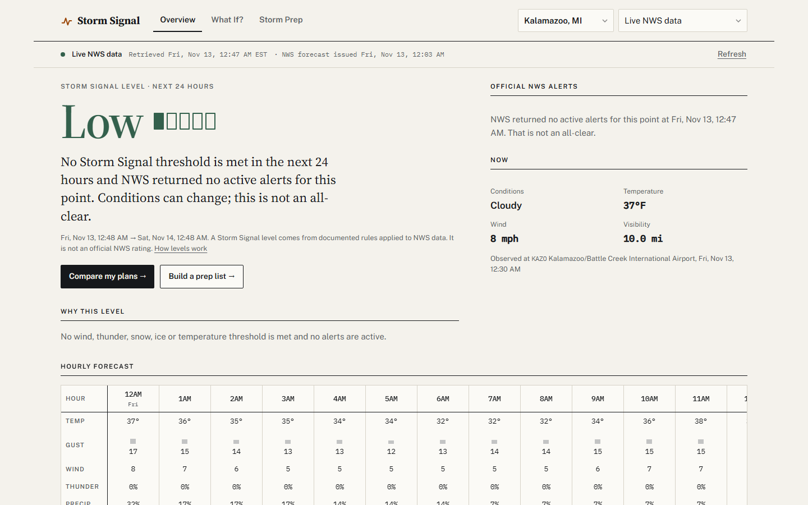
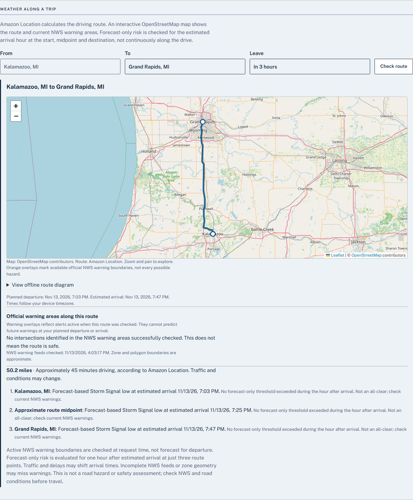
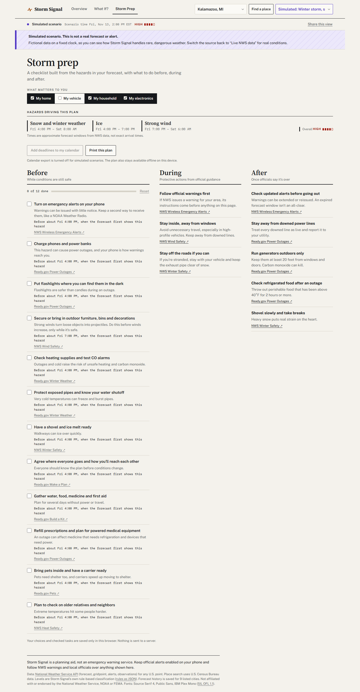
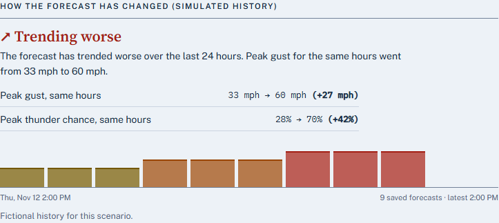
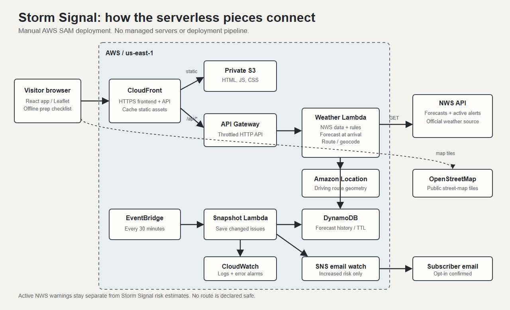

# Storm Signal: When the forecast changes, the plan should change too

**AWS Builder Center Weekend Challenge: No Pipeline, No Problem**

**Live project:** https://d3p9tcn7282g7r.cloudfront.net/
**Code and deployment guide:** https://github.com/kcasko/stormsignal
**Demo (public, 2:12):** https://youtu.be/tEDXWOmK88M

## The email that wasn't a storm warning

At 12:44 PM on November 13, I received an email saying the forecast risk in Kalamazoo had gone from Moderate to High.

It was a test. The message said **TEST ONLY** because it was generated from a synthetic forecast change, not an actual National Weather Service warning. The email delivered successfully, but the exercise exposed what matters when software deals with weather: if the app cannot tell the difference between a forecast planning update, an official warning, and a rehearsal, people have no reason to trust it.

That's the problem I wanted Storm Signal to solve.

Weather data gives us wind, rain, snow and timing. The questions people ask are more concrete. Should I make this drive now or later? What needs to be moved inside before the wind arrives? Has the forecast changed enough that I should rethink my plan?

I built a serverless web app that answers those questions **with measurable evidence**, not a confident-sounding prediction.

## From weather numbers to decisions

The **Overview** takes current National Weather Service data and produces a deterministic risk level, with the specific measurements and thresholds responsible. Official NWS alerts are shown separately, with their own instructions and geographic boundaries. If a forecast source is unavailable, the screen says **Unknown** rather than implying conditions are Low.

The **When to go** screen compares a few departure choices for driving, outdoor activities and home preparation. It shows when weather factors change and what would change the classification. There is also a route planner: Amazon Location Service calculates the driving route, a Leaflet/OpenStreetMap map shows it, and the backend checks available NWS warning polygons and zones against the route geometry. It estimates when the traveler will reach the start, midpoint and destination and evaluates hourly forecast data at those times.

A three-point forecast is **not** a continuous road-hazard scan. Current warning boundaries aren't promises about warnings at a future arrival. The UI says so.

Finally, **Storm Prep** turns supported forecast hazards into a checklist with reasons, approximate deadlines and links to official sources. The checklist works offline. For an urgent official warning, the interface moves those official instructions ahead of routine planning.

## The bugs that changed the design

The first version wasn't reliable enough.

One live forecast described a slight chance of rain and snow showers while the numeric forecast showed **0 inches** of snow. A wording-driven rule could overstate the risk. I changed it so numerical evidence takes precedence when available, then added regression coverage. Forecast prose and forecast measurements don't always say the same thing.

Another browser test exposed stale data appearing briefly under a **Simulated** banner when switching sources. The data hook now treats location and source as separate cache keys. Simulated severe-weather scenarios are useful for demonstrations, but they must never be confused with current NWS observations.

The initial SAM deployment also hit an actual AWS quota: this account couldn't reserve Lambda concurrency as requested. I made that setting optional and redeployed. The takeaway wasn't that serverless automatically eliminates operational limits. It removes server administration, while quotas and costs still need deliberate handling.

Later tests surfaced a quieter problem in the forecast-watch emails. An escalation message said Moderate to High but didn't explain the reason. The new message compares matching forecast hours and reports meaningful changes in wind, thunderstorm probability, snow or ice. We ran a synthetic escalation through the real SNS publisher and verified delivery to a confirmed inbox, clearly marked as a test.

## The actual AWS architecture

**The request path:** CloudFront serves the React application from a private S3 bucket and forwards `/api/*` to an API Gateway HTTP API. API Gateway invokes a Node.js Lambda. That Lambda retrieves NWS forecast, gridpoint, observations, and warning data, enforces upstream URL restrictions and timeouts, and runs the documented TypeScript risk rules. For route planning it calls Amazon Location Service. The browser uses OpenStreetMap only for street-map tiles.

**The scheduled path:** EventBridge Scheduler invokes a second Lambda every 30 minutes. It records new NWS forecast issuances and alert changes in DynamoDB, with a 72-hour TTL, so the UI can compare forecasts over time. An optional SNS subscription sends a planning email when the tracked city's computed risk rises. CloudWatch records operational errors.

Everything is described in `template.yaml` using AWS SAM and deployed manually, without a CI/CD pipeline or a server to administer. The public API has rate throttling, and the project has a tagged $10/month AWS budget that measures usage before promotional credits. Budget notifications are alerts, not hard spending caps.

## What I could actually verify

On **November 13, 2026**, the final feature build passed **101 unit/integration tests** and **48 Playwright browser checks**, with **8 additional checks intentionally skipped** for their environment. The SAM template passed validation. Live desktop/mobile checks exercised the deployed site, including the real route API and map tiles, and the CloudFormation stack reported `UPDATE_COMPLETE`.

The synthetic Moderate-to-High email was delivered through SNS. We **did not** encounter a real tornado warning during the live verification, and simulated cases should not be mistaken for real-world warning performance. A manual screen-reader review remains outstanding.

A particularly important test is a data failure: when an NWS source is unavailable, the application must say what it could not retrieve rather than quietly reporting a safe condition.

## The pattern worth reusing

The reusable idea is straightforward: **public data -> an explainable decision -> an honest failure state**.

Keep official facts separate from your interpretation. Show the thresholds. Store history if the source only exposes its latest forecast. Use labelled simulations for dangerous cases you cannot reproduce on demand. And never call a route "safe" based on three data points.

That pattern could work for air quality, transit disruptions or other public datasets. The source, AWS SAM template, architecture and deployment instructions are public in the repository.

**Try the live app:** https://d3p9tcn7282g7r.cloudfront.net/
**Explore the source:** https://github.com/kcasko/stormsignal
**Watch the demo:** https://youtu.be/tEDXWOmK88M

*Storm Signal supports planning. It is not an emergency-warning service. Follow official NWS alerts and local authorities.*

---

## Editor's final checks (remove before publication)

- [ ] Upload or host the screenshots in Builder Center: relative paths in Markdown will not work in the post editor.
- [x] Public video is available at https://youtu.be/tEDXWOmK88M (2:12). Add that URL to the dedicated **Demo** field when submitting the Builder Center project.
- [ ] Review screenshots for correct labels, dates and no private information. The route screenshot is from live NWS, not simulated.
- [ ] Verify no open draft placeholders remain in the published article.
- [ ] Confirm Builder Center registration, profile eligibility and unpublished-project requirement.
- [ ] Ensure no claim that three forecast samples establish an all-clear.
- [ ] Publish the post and submit the project **before Nov 16, 2026, 4 PM Eastern**.
