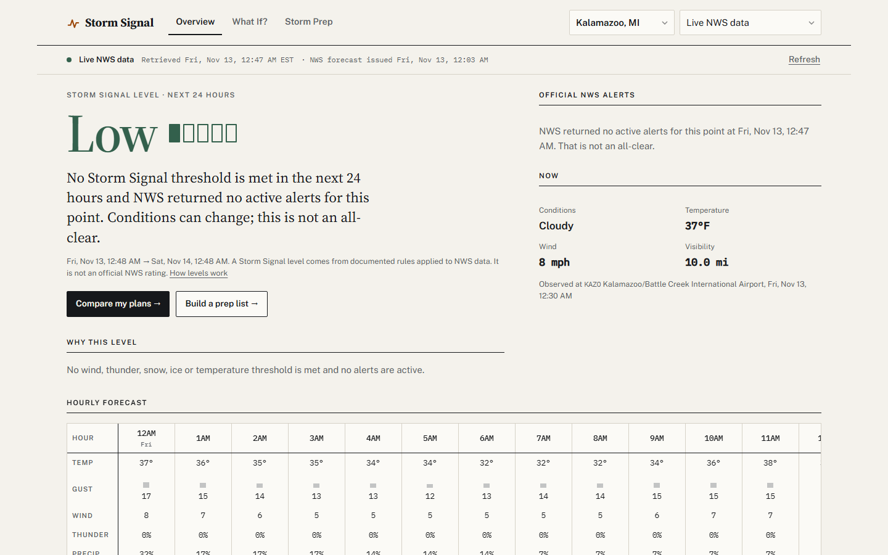
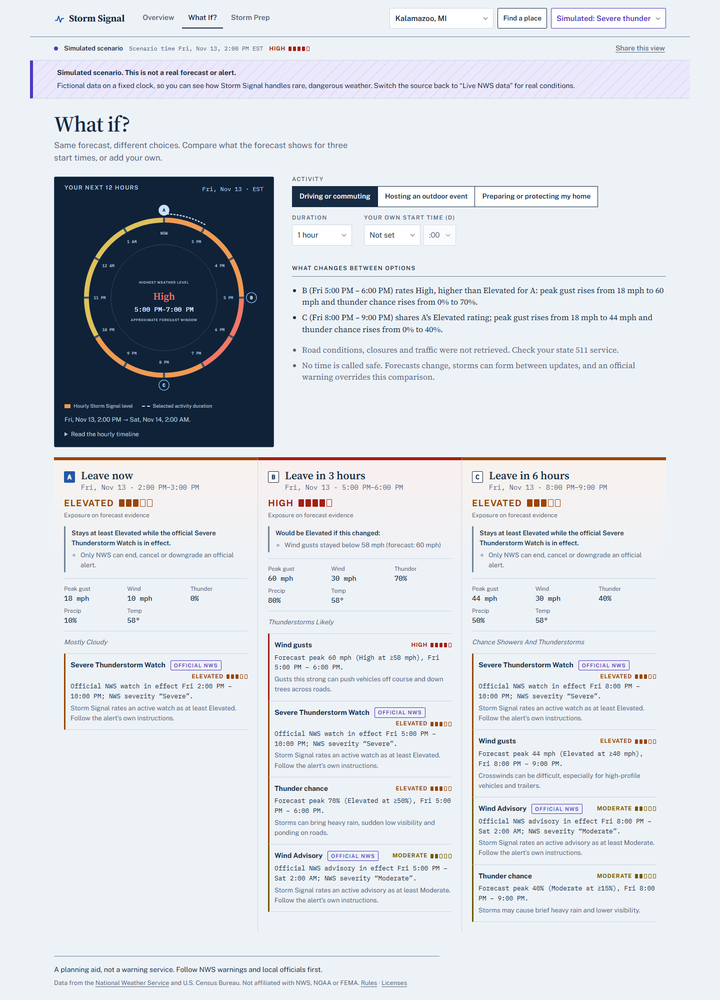
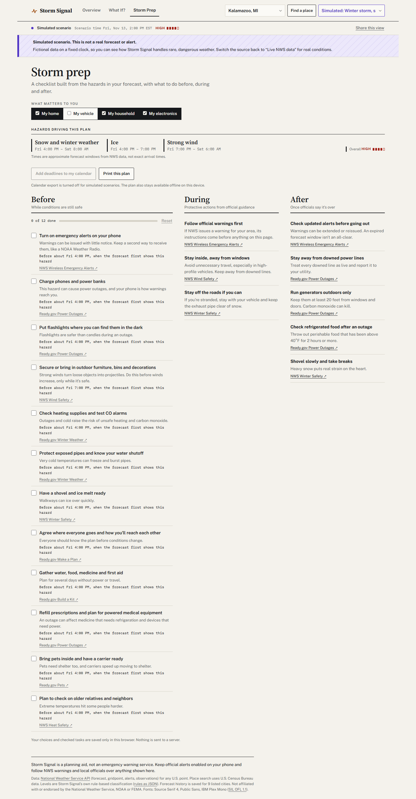
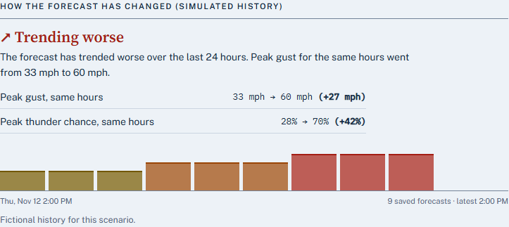
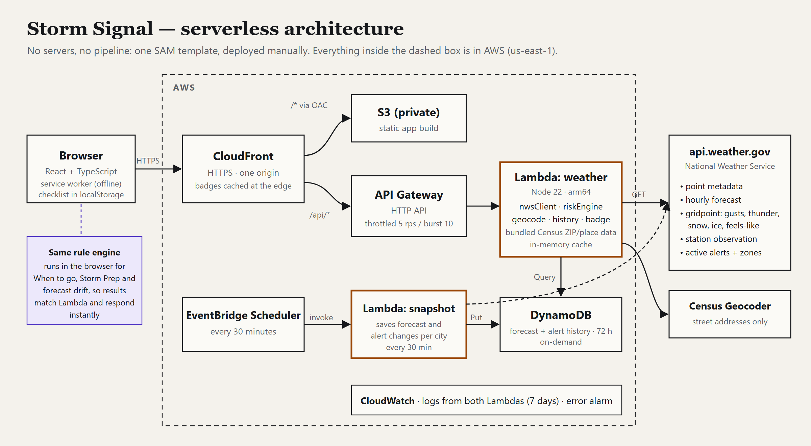

# Builder Center submission draft — NOT PUBLISHED

> Draft for review. Fill in the `[…]` placeholders after deployment and recording. Don't publish or submit without Keith's explicit go-ahead.
>
> **Pass/fail qualification checklist** (official terms, Nov 12, 2026; missing any item means no judging):
> - [ ] Working project using at least one serverless AWS service; no servers or pipelines to manage
> - [ ] Written project **published on AWS Builder Center** covering: the problem, what the build does, and the serverless services used **and how they connect**
> - [ ] Link to a **public** video (YouTube, Vimeo, Facebook Video or Youku), under 3:00, showing the build running end to end, in the submission's **demo** field
> - [ ] Original, not previously published; no third-party trademarks or unlicensed music in the video
> - [ ] Submitted by **Mon Nov 16, 1:00 PM PT** (4:00 PM ET); one entry per person
>
> Judging (Gate 1 is AI + human, Gate 2 human; 25% each): innovation/originality, craft/execution (how well the services fit and how reliably it runs), usefulness/impact (**including how easily others could reuse the pattern**), and storytelling.

---

## Storm Signal: one storm, different decisions

**Live app:** https://d3p9tcn7282g7r.cloudfront.net · **Demo:** [ADD PUBLIC VIDEO URL BEFORE PUBLISHING] · **Code:** https://github.com/kcasko/stormsignal (MIT)

### The problem

Weather apps answer "what will the weather do?" People actually need to know something else. Should I drive home now or wait? Do we move the party inside? What do I do to the house before the wind arrives?

A forecast of "40% thunderstorms, gusts to 45 mph" is accurate and still hard to act on. The official watches and warnings that *are* actionable get buried among everything else on the screen. Two people under the same storm face different risks: the commuter worries about crosswinds and visibility, the host about lightning and tents, the homeowner about loose objects and outages.

### What Storm Signal does

Storm Signal turns live National Weather Service data for **any U.S. place** (ZIP, city, street address or "use my location") into three connected answers:

1. **Overview: what's coming and why it matters.** A Storm Signal level (Low → Critical) for the next 24 hours. Every level comes with its evidence: *"Elevated because of wind gusts: forecast peak 48 mph (Elevated at ≥46 mph), Fri 2 PM – 7 PM."* Official NWS alerts appear separately with NWS's own severity and full instruction text. They are never blended into a made-up score. Below the level, Storm Signal says **what would change it**: *"Would be Moderate if wind gusts stayed below 46 mph (forecast: 48 mph)."* Each official alert gets an **area map** (NWS's storm-based polygon or its zone outlines, with "your location is inside") and a **timeline**: issued, updated, extended, scheduled end. Alerts that already ended stay visible for a day, marked *expired*, *cancelled*, *upgraded* or *ended early*, because "the warning is gone" and "the warning expired on schedule" mean different things. And a **forecast-drift panel** shows how the NWS forecast for the same hours has changed over the last day ("Trending worse: peak gust 33 → 60 mph"). A forecast that keeps moving is less certain, and most apps never show that.
2. **When to go: compare decisions.** Pick driving, an outdoor event, or home prep. Storm Signal compares *now*, *in 3 hours*, *in 6 hours* and **your own time** ("leave at 5:40 PM") using activity-specific thresholds, then answers first in one line (*"Lowest of these: A, leave now (Elevated). Highest: B, leave in 3 hours (High)."*) and explains in plain sentences what changes between options. A twelve-hour dial shows when the risk peaks and where each start time falls. It never calls a time "safe". **Share this view** sends the exact comparison to family as a link.
3. **Storm Prep: act before it hits.** A checklist generated from the hazards actually in the forecast and the areas you care about (home, vehicle, household, electronics). Each task has a reason, a deadline from the forecast ("before about 5 PM, when gusts first reach 30 mph"), and an NWS or Ready.gov source. It's organized Before / During / After, and progress is saved in your browser. One click adds the deadlines to any calendar app as reminders (.ics, no account). The plan prints cleanly and **still opens offline**, because during an outage is exactly when you need it.

**Built to be honest:**
- Missing or failed data is **Unknown**, never Low. Each NWS source fails independently and is reported on screen.
- An urgent warning (tornado, flash flood, severe thunderstorm…) puts the official NWS instruction at the top of every page and sets comparisons and routine tasks aside.
- There are no accident probabilities and no invented road conditions. No AI writes safety advice: every classification comes from documented, unit-tested rules.
- Simulated scenarios exist so judges can see rare, dangerous cases. They're permanently labelled and never replace failed live data.

<!-- Builder Center publishing note: upload each image below into the article editor and replace relative screenshot paths with hosted images before publishing. -->

### How it's built on AWS

- **Amazon CloudFront** serves the React/TypeScript app from a **private Amazon S3** bucket (Origin Access Control) and routes `/api/*` to the API, so there's one HTTPS origin, no CORS, and no credentials in the browser.
- **Amazon API Gateway (HTTP API)** with route throttling invokes **AWS Lambda** (Node.js 22, arm64).
- The Lambda calls five NWS endpoints in parallel (point metadata, hourly forecast, gridpoint data for gusts, thunder, snow and ice, the latest station observation, and active alerts). It allow-lists every upstream URL, enforces timeouts and size caps, converts units, and runs the deterministic risk engine. It caches in memory and coalesces duplicate requests to respect NWS.
- **Amazon Location Service Routes V2** calculates a driving route between two listed cities. A zoomable, pannable Leaflet/OpenStreetMap street map shows the route and current official NWS warning-area overlays. The user can choose a departure from now to 36 hours ahead; Storm Signal estimates arrival at the start, halfway point and destination using distance along the route and the provider's driving duration, then evaluates forecast-only risk for the hour after each estimated arrival. Active official warnings are shown separately and never represented as future predictions. This isn't navigation or road-safety advice.
- **Amazon SNS (opt-in)** emails an operator-confirmed subscriber when a tracked city's risk level rises. It compares matching forecast hours to explain meaningful changes, with clear warning-service limitations.
- **Amazon EventBridge Scheduler** invokes a second **Lambda** every 30 minutes. It saves each *new* NWS forecast issuance, and every change to the active alerts, for the listed cities to **Amazon DynamoDB** (on-demand, 72-hour TTL). The weather Lambda queries that history so the browser can compare the same forecast hours across issuances. Each Lambda has its own least-privilege role (Put vs. Query).
- **Any U.S. place** without a third-party service: ZIPs and city names resolve from public-domain U.S. Census Gazetteer data bundled in the Lambda, and only full street addresses go to the U.S. Census Geocoder. "Use my location" is rounded to about 1 km in the browser, and searches are never logged.
- **Amazon CloudWatch** receives one structured JSON log line per request (latency, which sources succeeded, resulting level), plus an error alarm. An AWS Budget alert guards cost.
- **Reliability:** 101 unit/integration tests on the rules, NWS client, geocoding, history, alert lifecycle, alert areas and calendar export, plus 48 Playwright browser tests on desktop and mobile. These include automated accessibility checks (WCAG AA) and an offline reload test against the production build.
- **AWS SAM** defines everything. I deploy with one `sam deploy` and an `s3 sync`: no servers, no pipeline.

The same TypeScript rule engine runs in Lambda for the overview and in the browser for the interactive When to go page, so results are identical and comparisons respond instantly. Every threshold is published as JSON at `/api/rules`.

### Reuse the pattern

The pattern underneath Storm Signal fits any "public data → explained decision" app: transit delays, air quality, river levels, wildfire smoke.

1. **CloudFront in front of both** a private S3 site and an HTTP API (`/api/*`). One origin, no CORS, no keys in the browser.
2. **One Lambda as a careful upstream client:** allow-listed URLs, timeouts, payload caps, independent per-source failure, in-memory caching and request coalescing.
3. **A deterministic rule engine shared by Lambda and the browser,** where every rule returns *evidence* (value, threshold, time window) instead of a bare score, and missing data yields "Unknown", never the safest answer.
4. **A scheduled snapshot plus TTL table** turns any "latest only" public API into a history you can reason about ("is this forecast settling or still moving?"), for pennies.
5. **Published rules** (`/api/rules`): others can audit the thresholds or reuse them in their own tools.
6. **An edge-cached SVG badge** (`/api/badge?loc=…`, a CloudFront cache policy keyed on `loc`): any school, event or club site can embed the live level with one line of HTML, and popular badges cost almost nothing.
7. **One `template.yaml`, one `sam deploy`:** throttling, log retention, an alarm and a budget included.

**Run it for your own area in about 10 minutes:** fork, list your cities in one file (`stormsignal.config.json`), deploy. The step-by-step guide is in [docs/reuse.md](https://github.com/kcasko/stormsignal/blob/main/docs/reuse.md). Swap the NWS client and the rule tables, and the rest carries over to other public data. Code, template and rules: https://github.com/kcasko/stormsignal (MIT).

### What I learned

- Gridpoint data matters more than the hourly forecast for decisions: gusts, thunder probability and snow/ice amounts aren't in the hourly product.
- "Slight chance snow showers" with a known 0 in of snow shouldn't raise a level. Numeric evidence now outranks vague wording, and that's covered by a regression test found during the live check.
- Writing explanations was harder than writing thresholds. Every rule had to produce a sentence a person could check, and the inverse ("what would change it") turned out to be the most useful sentence of all.
- The NWS API only serves the latest forecast. Saving issuances on a schedule is what made "is this forecast trustworthy?" answerable.

### What's next

Forecast history for any place someone saves; push reminders tied to prep deadlines; a manual screen-reader audit; Spanish-language guidance.

*Storm Signal is a planning aid, not an emergency warning service. Always follow NWS warnings and local officials.*
